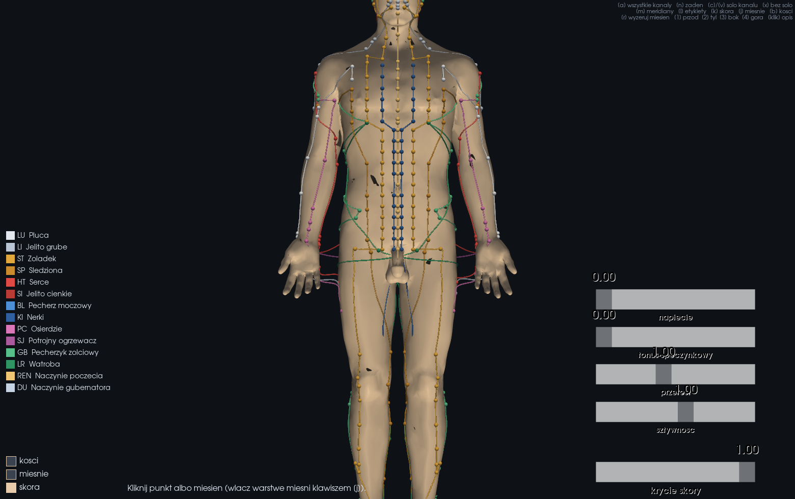
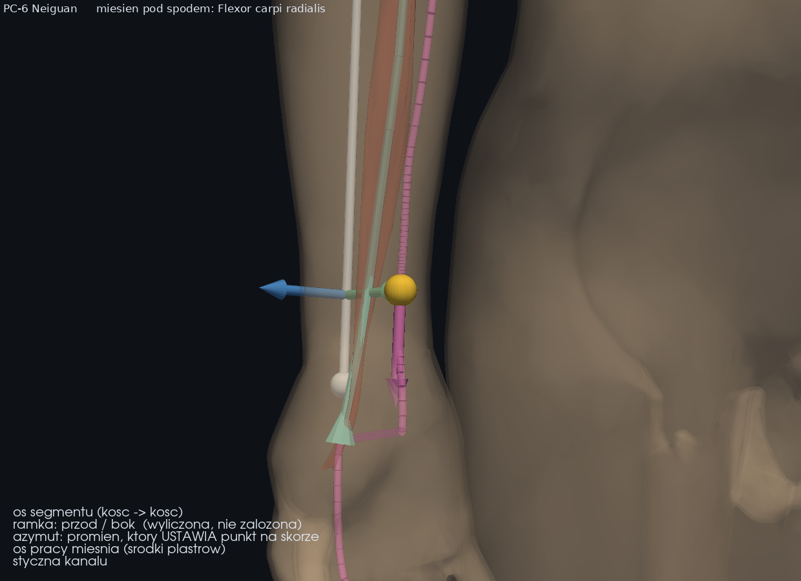
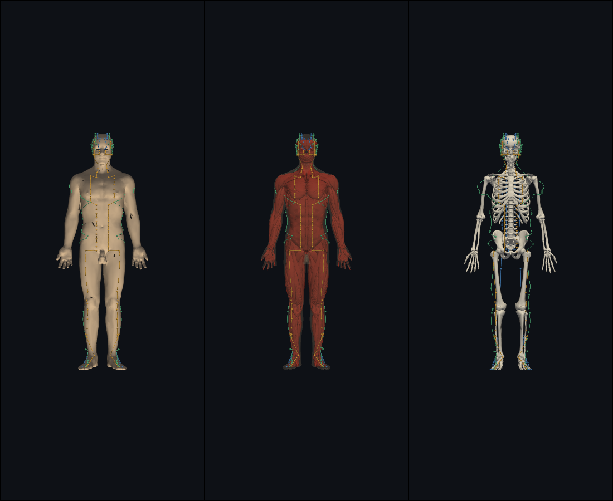
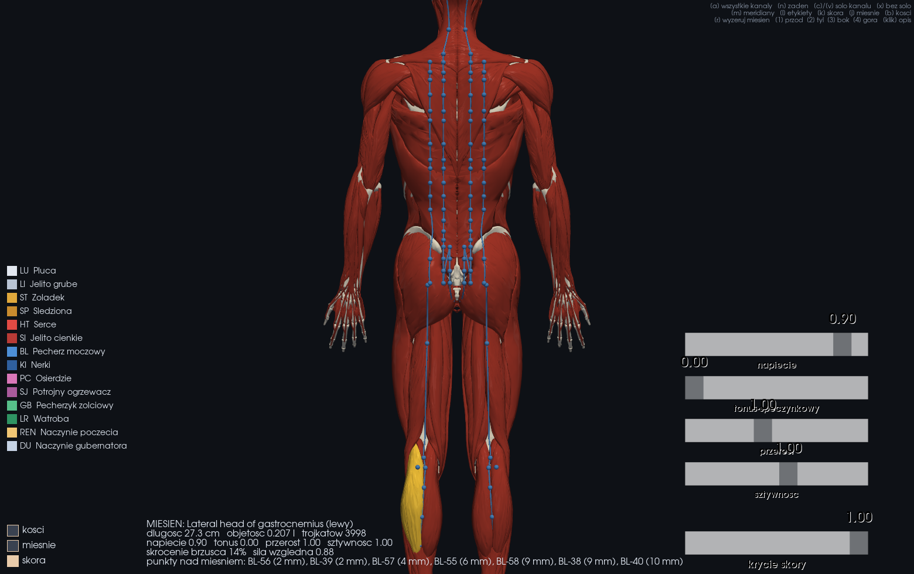
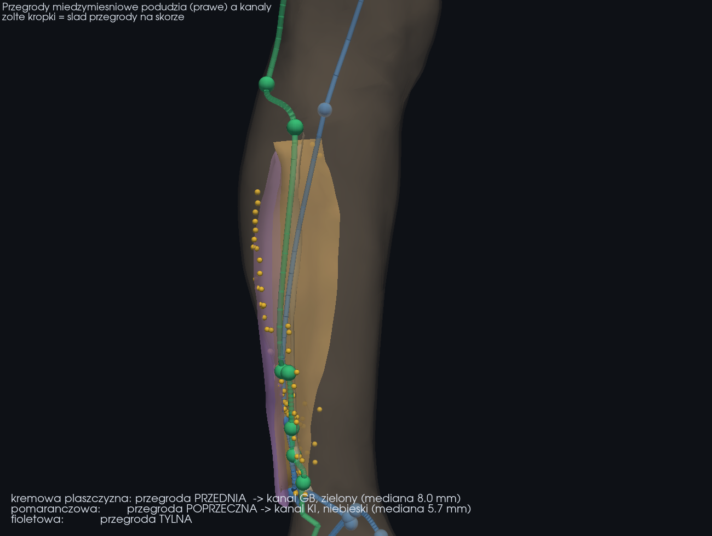
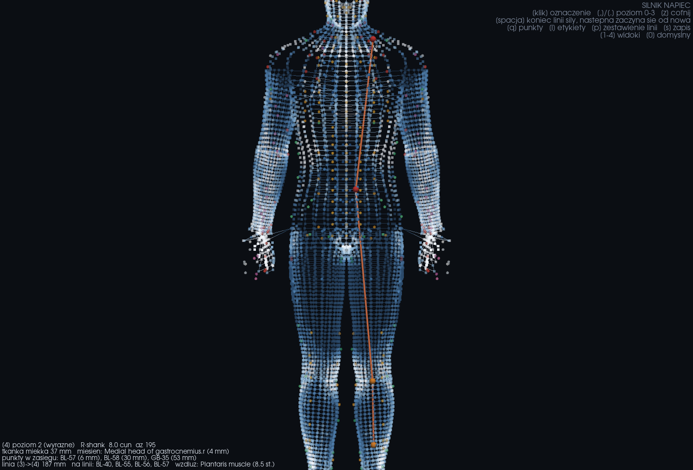
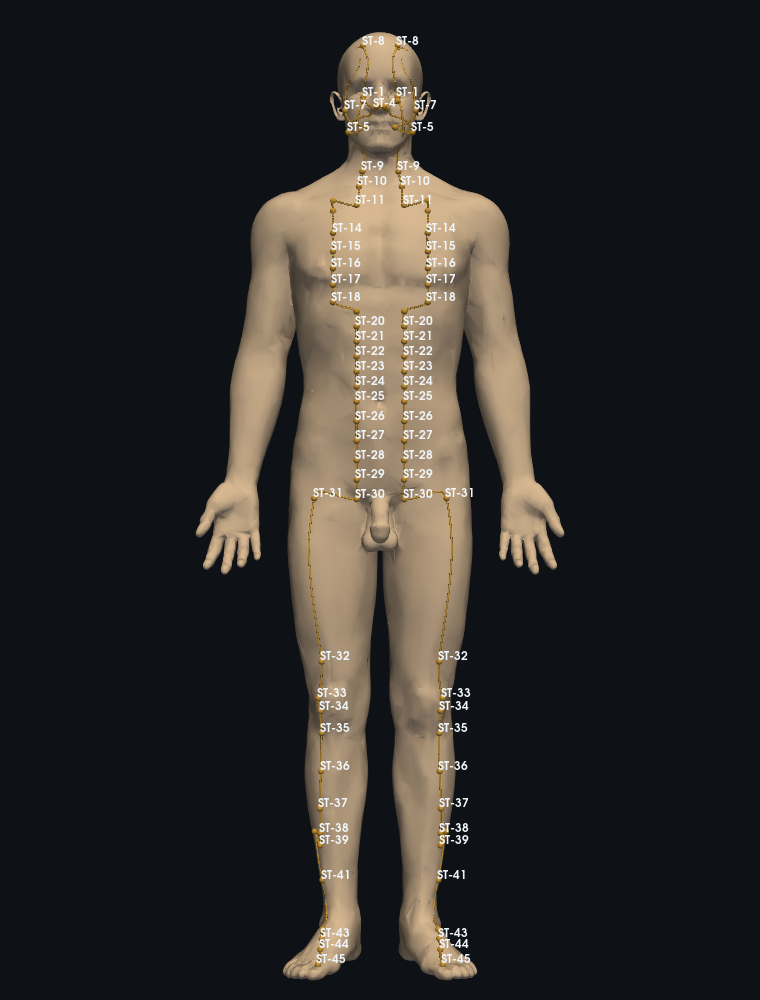

# Atlas punktów akupunktury 3D

Przeglądarka 3D prawdziwego modelu anatomicznego z **361 punktami** klasycznych 14 kanałów.
Warstwy ciała (skóra / mięśnie / kości) przełączasz w locie, kanały włączasz pojedynczo,
a kliknięcie punktu pokazuje jego opis i **mięsień, który leży pod igłą**.

Mięśnie są osobnymi obiektami: klikasz konkretny mięsień, dostajesz jego nazwę, długość,
objętość i listę punktów akupunkturowych leżących nad nim — a suwakami zmieniasz jego
napięcie, tonus spoczynkowy, przerost i sztywność.

Python + PyVista (VTK).



## Skąd biorą się położenia punktów

Punkty **nie mają wpisanych współrzędnych XYZ**. Każdy opisany jest kotwicą proporcjonalną —
dokładnie tak, jak opisuje go podręcznik:

```json
{ "code": "ST-36", "anchor": { "seg": "shank", "cun": 3, "from": "p0", "az": 22 } }
```

„Na podudziu, 3 cun poniżej ST-35, szerokość palca bocznie od grzebienia piszczeli”.
Dopiero rig zamienia to na metry. Linijka *cun* nie jest zgadnięta — liczy się ją
z **prawdziwych kości** modelu (`tools/calibrate_rig.py`): wyrostków kolczystych kręgów,
wcięcia szyjnego mostka, wyrostka mieczykowatego, górnego brzegu spojenia łonowego,
krętarza większego, szpary stawu kolanowego i kostek.

Dla tego modelu wychodzi 2,48 cm na 1 cun w pionie tułowia i 2,07 cm w poziomie —
i stąd BL-23 ląduje 1,5 cun od linii pośrodkowej, a BL-52 3 cun, obydwa na wysokości L2.

Konsekwencja praktyczna: **wymiana modelu ciała nie unieważnia żadnej z 361 kotwic.**



Na PC-6 widać wszystkie rodziny wektorów naraz: biała oś odcinka biegnie od łokcia do
nadgarstka, zielona i niebieska strzałka to ramka poprzeczna (przód / bok) wyliczona
z tej osi, złoty promień jest tym, co **stawia punkt na skórze**, turkusowa linia to oś
pracy mięśnia pod spodem, różowa — styczna kanału.

## Przebiegi kanałów

Kanał nie biegnie łamaną od punktu do punktu, więc linie prowadzi splajn
Catmulla-Roma zapisany jako łańcuch sześciennych krzywych Béziera. W odróżnieniu
od zwykłego Béziera taki splajn **przechodzi przez węzły** — a węzłami są punkty
akupunkturowe, więc krzywa nie może ich omijać (sprawdzane: maksymalne odchylenie
0,000 mm). Parametryzacja dośrodkowa zamiast równomiernej ma tu znaczenie: odstępy
między punktami wahają się od 1 cun do kilkunastu centymetrów, a przy równomiernej
takie nierówności dają pętle i ostrza.

Gotowa krzywa jest rzutowana na skórę, wygładzana z drgań rzutowania i ponownie
rzutowana — ale tylko w tych 5% próbek, które wygładzanie ruszyło o więcej niż
milimetr. Wyniki lądują w pamięci podręcznej, więc kolejne uruchomienia startują
w około 3 sekundy zamiast 7.

## Warstwy



| warstwa | źródło | liczby |
|---|---|---|
| skóra | BodyParts3D (`FMA7163`) | 90 tys. trójkątów |
| mięśnie | Z-Anatomy, 477 osobnych obiektów | 1,08 mln trójkątów |
| kości | Z-Anatomy, 1244 obiekty scalone | 220 tys. trójkątów |
| tkanka łączna | Z-Anatomy, 198 obiektów (klawisz `h`) | 237 tys. trójkątów |

Oba zbiory są w innych układach odniesienia. Przesunięcia nie zgadujemy — liczymy je,
porównując położenie **tej samej kości** (krzyżowej i żuchwy) w obu zbiorach.
Skala wychodzi 1.0, co potwierdza, że to fizycznie ten sam model.

## Mięśnie: wybór i modulacja



Kliknięcie w mięsień zaznacza go na żółto i pokazuje panel. Mięsień kurczy się wzdłuż
swojej osi głównej, a przyczepy zostają na kościach:

```
s    = s_max · (napięcie · sztywność + tonus)     skrócenie, s_max = 0,16
w(t) = sin(π·t)                                   0 na przyczepach, 1 w brzuścu
u'   = u · (1 − s·w)                              wzdłuż osi
r'   = r / √(1 − s·w)                             w poprzek — objętość bez zmian
```

Pogrubienie brzuśca nie jest osobnym suwakiem: wynika z zachowania objętości.
Przerost i zanik to druga, niezależna gałka, bo to inne zjawisko.

### Linie pracy

Mięsień ma kierunek działania, nie tylko objętość. Klawisz `w` rysuje oś ciągu:
rurka biegnie środkiem brzuśca, a groty na obu końcach pokazują, że **oba przyczepy
ciągną do brzuśca**, bo to on się skraca. Linia nie jest prostą między przyczepami —
powstaje ze środków ciężkości kolejnych plastrów mięśnia wzdłuż jego osi, więc idzie
środkiem także przy mięśniach wygiętych, zamiast przecinać je na skros.

Włączenie linii przymgla warstwę mięśni, bo inaczej byłyby schowane w środku brył.

Powiązanie działa w obie strony:

- wybierz mięsień → dostajesz punkty leżące nad nim wraz z odległością
  (mięsień brzuchaty łydki wskazuje BL-57 Chengshan w 4 mm, naramienny — LI-15 w 6 mm),
- kliknij punkt → dostajesz mięsień pod nim i głębokość, na jakiej się zaczyna.

## Tkanka łączna: powięzie i przegrody



Przez pierwsze wersje ta warstwa była **świadomie wyrzucana**. `prepare_meshes.py` miał
listę odsiewającą wszystko, co nie jest brzuścem mięśnia, i wycinała ona 206 struktur:
78 kaletek, 40 powięzi, 40 pochewek ścięgnistych, 18 troczków, 14 przegród
międzymięśniowych, 6 rozcięgien, 6 więzadeł. Dla atlasu punktów była to decyzja słuszna —
te płaty otaczają mięśnie, więc przechwytywałyby każde kliknięcie.

Przestała być słuszna, kiedy doszła mapa napięć. To, co palec wyczuwa jako napięcie, to
w dużej mierze powięź i ślizg między warstwami, a nie brzusiec leżący głębiej. Dlatego
tkanka łączna wróciła — jako **osobna warstwa**, nie domieszka do mięśni:

```bash
python tools/prepare_fascia.py
```

Powięź opisuje się inaczej niż mięsień. Mięsień jest walcem i ma **oś**; powięź jest
płatem i ma **normalną** — kierunek w poprzek płata, liczony jako oś najmniejszej
wariancji chmury punktów. W zestawieniu mapy napięć widać oba kąty: kierunek napięcia
względem osi mięśnia i względem płata (90° = ciągnie wzdłuż powięzi, 0° = rozciąga ją
na przestrzał).

Klawisz `h` dokłada kolejne klasy: przegrody, powięzi, troczki, rozcięgna, pochewki,
kaletki. Warstwa ładuje się dopiero przy pierwszym użyciu.

### Czy kanały biegną bruzdami?

Przegrody międzymięśniowe wyznaczają granice między grupami mięśni, a te granice widać
na skórze jako bruzdy. To pozwala postawić hipotezę z poprzedniej rozmowy w wersji
**mierzalnej**: czy punkty i przebiegi kanałów leżą bliżej śladu przegrody niż przeciętne
miejsce w tej samej okolicy?

```bash
python tools/analyze_septa.py
```

Metoda: bierzemy najpłytszą ćwiartkę każdej przegrody, rzutujemy ją na skórę (żółte
kropki na rysunku), liczymy odległość badanego miejsca do tego śladu, a potem **to samo
dla losowych miejsc skóry w promieniu 9 cm**. Bez tego tła liczba w milimetrach nic nie
znaczy — na cienkim podudziu wszystko jest blisko wszystkiego. Wynikiem jest percentyl:
0.50 oznaczałoby brak jakiegokolwiek związku.

Z-Anatomy ma nazwane przegrody tylko dla ramienia, uda i podudzia, więc pomiar dotyczy
122 punktów kotwiczonych na tych odcinkach.

| co | mediana odległości | percentyl względem tła |
|---|---|---|
| punkty (n=122) | 46,1 mm | **0,426** (p = 0,10) |
| próbki linii kanałów (n=464) | 53,7 mm | 0,404 |

Czyli: w wersji mocnej — „kanały biegną bruzdami" — **hipoteza się nie broni**. Przewaga
nad tłem jest, ale niewielka i nieistotna statystycznie.

Rozbicie na kanały pokazuje jednak, że pytanie było źle postawione:

| kanał | n | mediana | percentyl |
|---|---|---|---|
| KI | 8 | **5,7 mm** | 0,13 |
| LI | 8 | 24,7 mm | 0,20 |
| GB | 20 | **8,0 mm** | 0,21 |
| LR | 14 | 45,0 mm | 0,32 |
| SP | 12 | 34,7 mm | 0,35 |
| BL | 22 | 55,7 mm | 0,52 |
| ST | 20 | 83,8 mm | 0,55 |
| SJ | 10 | 53,0 mm | 0,65 |

Trzy kanały siedzą na przegrodach z dokładnością do kilku milimetrów, reszta nie ma z nimi
nic wspólnego. GB-35 do GB-39 leżą na przegrodzie **przedniej** podudzia (od 3,5 do 8,3 mm),
KI-7, KI-8, KI-9 oraz BL-58 i BL-59 na przegrodzie **poprzecznej** (od 1,1 do 9,6 mm).
To zgadza się z podręcznikowym opisem tych punktów, a nie zostało w model wpisane — model
nie zna słowa „przegroda", zna tylko geometrię.

Uczciwa granica tego wyniku: kanał jest tu jednostką obserwacji, a jest ich dziewięć.
Przy takiej próbie mediana percentyli 0,346 daje p = 0,33, czyli **nie da się odrzucić
przypadku**. To jest hipoteza dobrze postawiona i warta sprawdzenia na większym materiale,
a nie wynik.

## Silnik napięć: siatka cunowa bez warstw



```bash
python -m acu3d --wire
```

Warstwy służyły do tego, żeby **model wiedział**, co gdzie leży. Do pracy z napięciami
ta wiedza jest potrzebna, ale same siatki już nie — wystarczy ich wynik. `tools/bake_wire.py`
przenosi wiedzę z geometrii do skalarów na rzadkiej siatce:

| | pełna przeglądarka | silnik `--wire` |
|---|---|---|
| geometria ciała | 1,4 mln trójkątów | 9144 wierzchołki, 15 tys. linii |
| na dysku | ~700 MB w `assets/` | **211 kB** (`data/wire.npz`) |
| start okna | 2,5 s | 1,5 s |
| siatki anatomiczne wczytywane w czasie pracy | wszystkie | **żadna** |

A mimo to po każdym kliknięciu model dalej mówi, ile w tym miejscu jest tkanki miękkiej,
który mięsień leży pod spodem i jak głęboko — bo to jest wypieczone w wierzchołkach:

```
[3] poziom 2 (wyrazne)   R·shank  8.0 cun  az 195
tkanka miekka 37 mm   miesien: Medial head of gastrocnemius.r (4 mm)
```

Siatka nie jest rysunkiem ciała. To **widoczny układ współrzędnych atlasu**: pierścienie
to poziomy w *cun*, linie podłużne to azymuty — dokładnie ten układ, w którym opisane są
punkty. Barwa linii to grubość tkanki miękkiej: białe tam, gdzie kość leży tuż pod skórą
(piszczel, łokciowa, kostki), ciemne tam, gdzie jest gruby brzusiec.

Kliknięcie **przyciąga się do siatki**, więc oznaczenie nigdy nie ląduje pomiędzy —
zawsze ma swoje *cun* i azymut, tak samo jak punkt akupunkturowy.

### Linie sił

Oznaczenia stawiane po kolei tworzą **łańcuch**, rysowany jako wektor ze strzałką.
`spacja` zamyka łańcuch, następne kliknięcie zaczyna nowy. Zestawienie (`p`) podaje dla
każdego odcinka trzy mierzalne rzeczy: długość, **punkty akupunkturowe w korytarzu wzdłuż
linii** i **mięśnie, których oś pracy jest z tą linią zgodna**:

```
[1] -> [2]  438 mm
   punkty na linii: GB-21 (9 mm od osi), BL-47 (23 mm), BL-48 (12 mm), BL-49 (8 mm)…
   wzdluz linii: Descending part of trapezius (prawy)  os pod 3.9 st., glebokosc 13 mm
   wzdluz linii: Latissimus dorsi (prawy)              os pod 12.4 st., glebokosc 17 mm
[2] -> [3]  562 mm
   punkty na linii: DU-3 (26 mm), BL-25 (6 mm), BL-26 (11 mm), BL-40 (4 mm)…
   wzdluz linii: Long head of biceps femoris (prawy)   os pod 2.6 st., glebokosc 23 mm
```

Kąt mówi tylko tyle, że mięsień **może** ciągnąć wzdłuż tej linii: 0° = oś równoległa,
90° = w poprzek. To geometria, nie rozpoznanie — i tak jest opisane w samym zestawieniu.

`f` włącza **filtr wiedzy**: z 722 markerów zostają te, które linie sił rzeczywiście
mijają. To ten sam korytarz, którego używa zestawienie, więc to, co widać na ekranie,
i to, co wypisane na konsoli, jest jednym zbiorem.

| klawisz | działanie |
|---|---|
| `klik` | oznaczenie napięcia — od razu, bez wchodzenia w tryb |
| `,` `.` | poziom 0–3 |
| `spacja` | zamknij linię siły, następna zaczyna się od nowa |
| `z` | cofnij ostatnie oznaczenie |
| `q` `l` | punkty / etykiety kodów |
| `f` | filtr: tylko punkty leżące na liniach sił |
| `p` `s` | zestawienie linii / zapis sesji |
| `1`–`4`, `0` | widoki |

Zapisy sesji są wymienne z pełną przeglądarką — to ten sam format, z dodanym polem
`chains` (łańcuchy) i kotwicą `anchor` w układzie *cun*. Nadal zostają lokalnie.

### Przebudowa siatki

```bash
python tools/bake_wire.py --step 0.5 --rays 24
```

Dwa odsiewy są tu istotne. Promień, który uciekł przez otwór w siatce skóry (oczodół,
szpara między palcami), nie opisuje powierzchni — jego wierzchołek zostaje w danych,
bo ma poprawne *cun* i azymut, ale nie łączymy go z sąsiadami i oznaczenie nie może na
nim usiąść. Promień z tułowia, który trafił w przylegające ramię, poznajemy po tym, że
kończy bliżej osi kończyny niż osi własnego odcinka — przy domyślnych ustawieniach
odsiewa to 474 wierzchołki i usuwa „gwiazdy" w środku sylwetki.

## Mapa napięć

Tryb pracy z pacjentem: klawisz `t`, potem klikasz w ciało i zostawiasz oznaczenie
napięcia. Klawisze `,` i `.` zmieniają poziom (0–3), `g` nadaje ostatniemu oznaczeniu
**kierunek** — klikasz tam, dokąd ciągnie napięcie. `z` cofa, `s` zapisuje sesję,
`p` wypisuje zestawienie.

Trzy rzeczy zostały zaprojektowane celowo:

**Oznaczenie jest kotwiczone anatomicznie**, a nie we współrzędnych. Zapisujemy mięsień
i położenie względem jego osi, więc ten sam zapis da się nałożyć na inną sylwetkę —
dokładnie tak jak punkty w tym projekcie.

**Napięcie ma zwrot.** Kierunek jest porównywany z osią włókien mięśnia pod spodem
(„kierunek vs włókna: 88,7°" oznacza napięcie prawie prostopadłe do przebiegu włókien).

**Zestawienie jest sprawdzalne.** Nie zgaduje przyczyn — wypisuje, co leży pod
oznaczeniem i w jego zasięgu: mięsień z odległością w milimetrach, punkty w promieniu
z odległością, ich kanały i **cytowane z podręcznika działanie**. Każdą pozycję da się
sprawdzić na modelu. To jest spis faktów geometrycznych, nie rozpoznanie.

```bash
python -m acu3d --tension data/tension/sesja-2026-08-26-2356.json --tension-report
```

Analiza jest regułowa, liczona z danych — nie jest modelem językowym i nie wnioskuje
poza tym, co da się zmierzyć. Podsumowanie językowe można dołożyć później, ale wtedy
dane opuszczają komputer i to jest osobna decyzja.

Zapisy sesji (`data/tension/`) są wyłączone z repozytorium — to obserwacje kliniczne.

## Instalacja

```bash
python -m venv .venv
.venv\Scripts\pip install -r requirements.txt
```

Siatek anatomicznych **nie ma w repozytorium** (setki MB, licencja CC BY-SA).
Pobiera je i przetwarza jeden skrypt — potrzebny jest zainstalowany
[Blender](https://www.blender.org/) (Z-Anatomy trzyma całą anatomię w pliku `.blend`):

```bash
.venv\Scripts\python tools\fetch_assets.py
```

Skrypt pobiera Z-Anatomy (~87 MB) i BodyParts3D (~140 MB), eksportuje siatki, obraca je
do naszego układu, decymuje i kalibruje rig. Trwa to kilkanaście minut, raz.

Bez pobranych zasobów aplikacja i tak działa — przechodzi na wbudowany model proceduralny
(`python -m acu3d --procedural`), z tymi samymi punktami na uproszczonym manekinie.


### Gdy Windows blokuje VTK

Windows ze **Smart App Control** w trybie wymuszania blokuje niepodpisane biblioteki
VTK (dziennik CodeIntegrity, Id 3077: *did not meet the Enterprise signing level
requirements*). Aplikacja przestaje wtedy startować, mimo że kod jest w porządku.

Obejście bez osłabiania zabezpieczeń systemu: uruchamianie w WSL2, bo binaria
linuksowe tej polityce nie podlegają, a WSLg daje okno graficzne.

```bash
wsl --install -d Ubuntu-24.04 --no-launch
wsl -d Ubuntu-24.04 -u root bash tools/setup_wsl.sh
```

Potem wystarczy `uruchom-wsl.cmd` albo:

```bash
wsl -d Ubuntu-24.04 -u root bash tools/run_wsl.sh
```

Zasoby anatomiczne są widoczne przez `/mnt/c`, więc nie trzeba ich generować od nowa.

## Uruchomienie

```bash
.venv\Scripts\python -m acu3d
```

```bash
.venv\Scripts\python -m acu3d --channel ST --labels --view front
```

```bash
.venv\Scripts\python -m acu3d --muscle gastrocnemius --activation 0.9 --layer muscle
```

## Sterowanie

| | |
|---|---|
| lewy przycisk myszy | obrót; kółko — zoom; prawy — przesunięcie |
| klik w punkt | opis w oknie + pełny opis na konsoli + **automatyczny wybór mięśnia pod punktem** |
| klik w mięsień | zaznaczenie i panel parametrów (gdy warstwa mięśni jest włączona) |
| **`f`** | **fokus**: reszta ciała staje się prawie przezroczysta, a wybrany punkt i mięsień trafiają w środek obrotu; `f` ponownie — powrót do poprzedniego widoku |
| `1` `2` `3` `4` | widok przód / tył / bok / góra, `0` — widok domyślny |
| `a` / `n` / `i` | wszystkie kanały / żaden / odwróć zaznaczenie |
| `c` `v` | solo kolejnego kanału (z etykietami), `x` — wszystkie z powrotem |
| `m` `l` | linie kanałów / etykiety kodów |
| `k` `j` `b` | skóra / mięśnie / kości |
| `h` | tkanka łączna — kolejne wciśnięcia dokładają klasy, od przegród do kaletek |

Dwa tryby uproszczone: `--bare` (sam silnik ruchu i zaznaczania punktów, bez mięśni) oraz `--wire` (siatka cunowa i linie sił, bez żadnych siatek anatomicznych).
| `r` | wyzeruj parametry wybranego mięśnia |
| `w` | linie pracy mięśni — oś ciągu z grotami skierowanymi ku brzuścowi |
| `t` | mapa napięć: klik stawia oznaczenie, `,`/`.` poziom, `g` kierunek, `z` cofnij |
| `s` `p` | zapisz sesję mapy napięć / wypisz zestawienie |

Po lewej: przełączniki warstw (dół), lista kanałów z przyciskami **wszystkie / żaden / odwróć**.
Po prawej: suwaki parametrów mięśnia, przyciski **fokus** i **zeruj mięsień**, krycie skóry.

### Wydajność

Ruch suwakiem przelicza jedną klatkę w **ok. 5 ms**. Osiąga się to dwoma sztuczkami:
wybrany mięsień jest rysowany jako osobny aktor (a w wielkiej siatce wszystkich mięśni
jego komórki stają się przezroczyste), więc na kartę idzie kilka tysięcy wierzchołków
zamiast pół miliona; mapowanie punkt↔mięsień liczy się raz na mięsień i zostaje w pamięci,
bo nie zależy od parametrów.



## Struktura

```
acu3d/
  anatomy.py    cialo z siatek + linijka cun z kosci; powierzchnia szukana promieniem
  rig.py        model proceduralny (zapasowy) - proporcje z tabeli
  anchors.py    kotwica -> wspolrzedne 3D
  muscles.py    477 miesni w jednej siatce, deformacja aktywacyjna
  fascia.py     198 platow lacznotkankowych; plat opisuje normalna, nie os
  wire.py       siatka cunowa z wypieczona wiedza o tkankach (bez siatek 3D)
  wire_viewer.py  silnik napiec: oznaczenia, lancuchy sil, filtr wiedzy
  model.py      spina cialo, punkty i meridiany
  viewer.py     okno, warstwy, wybor punktu i miesnia
data/
  points.json      361 kotwic + polskie notatki o lokalizacji
  muscles.json     katalog miesni: os dzialania, objetosc, strona
  rig_fitted.json  punkty kostne i linijka cun zmierzone na modelu
  meridians.json   przebiegi kanalow
  fascia.json      katalog tkanki lacznej: klasa, normalna platu, rozpietosc
  wire.npz         siatka cunowa: 9144 wierzcholki + skalary tkanek (211 kB)
  wire.json        opis siatki i osie miesni do analizy linii sil
  septa_analysis.json  pomiar: kanaly a przegrody miedzymiesniowe
  tension/         zapisy sesji z mapami napiec (poza repozytorium)
tools/
  fetch_assets.py      pobranie i przygotowanie calej anatomii (jeden skrypt)
  blender_export.py    eksport siatek z pliku .blend
  prepare_meshes.py    obrot, decymacja, os glowna miesnia
  prepare_fascia.py    warstwa lacznotkankowa (powiezi, przegrody, troczki)
  bake_wire.py         wypiek siatki cunowej: wiedza z siatek -> skalary
  prepare_skin.py      skora BodyParts3D dopasowana do anatomii
  calibrate_rig.py     linijka cun z prawdziwych kosci
  build_points.py      tabele kotwic -> data/points.json
  prepare_structs.py   drobne struktury (paliczki, malzowina, galka oczna)
  setup_wsl.sh         srodowisko w WSL2 (obejscie blokady Smart App Control)
  run_wsl.sh           uruchomienie atlasu w WSL2
  validate.py          kontrola spojnosci atlasu
  verify_points.py     zgodnosc z opisami zrodlowymi
  fit_azimuth.py       pomiar kata ulozenia punktu wzgledem miesni
  analyze_septa.py     czy kanaly biegna bruzdami miedzy grupami miesni
```

## Dokładność i jak jest sprawdzana

Kotwice wpisałem ręcznie na podstawie opisów podręcznikowych — **nie ma za nimi żadnej
bazy współrzędnych**. Dlatego są dwa niezależne narzędzia kontrolne.

`tools/validate.py` — spójność wewnętrzna: czy punkty leżą na skórze, czy strony się nie
mieszają (punkt prawej strony nie może mieć ujemnego x), czy pary L/R są symetryczne.

`tools/verify_points.py` — zgodność z opisami źródłowymi. Wyciąga z tekstu liczby, które
da się zmierzyć, i porównuje je z geometrią modelu:

| test | wynik | co dowodzi |
|---|---|---|
| odległość boczna (54 pkt) | 54/54, mediana 0,08 cun | poprawność przepisania liczb |
| poziom kręgu (31 pkt) | 30/31 | poziom brany z realnej kości |
| odległość wzdłuż (32 pkt) | 31/32, mediana 0,00 cun | poprawność przepisania |
| **zgodność mięśnia (30 pkt)** | **25/30 (83%)** | **test w pełni niezależny** |

Ostatni jest jedyny, który może złapać błąd: nazwa mięśnia pochodzi z podręcznika,
geometria z Z-Anatomy, a pozycja z moich kotwic — trzy różne źródła. To on wykrył,
że LR-10 i LR-11 lądowały na przeciwnej nodze.

`tools/fit_azimuth.py` — kąt ułożenia punktu wokół kończyny był jedyną wartością wpisywaną
na oko. Tam, gdzie opis nazywa mięsień lub ścięgno, kąt jest **mierzony**: skanujemy pełny
obrót i wybieramy ten, przy którym punkt leży na nazwanej strukturze, a przy opisie
„między X a Y" — pomiędzy nimi. Bramka jakości odrzuca przypadki, w których punkt nie
dosięga struktury; to znaczy, że nazwa trafiła do tekstu mimochodem, z podpisu ryciny.

### Znacznik `accuracy` przy każdym punkcie

- **structural** (89) — kotwica przy nazwanej strukturze: paliczku, kości śródręcza,
  skrawku małżowiny, gałce ocznej,
- **anchored** (271) — kotwica proporcjonalna w cun wobec punktów kostnych,
  z czego 25 ma kąt zmierzony względem mięśni zamiast wpisanego,
- **approx** (1) — HT-1, bo model nie ma zachyłka pachowego.

To nie jest wyrób medyczny ani pomoc do samodzielnego nakłuwania. Narzędzie do nauki
topografii — punkt na ekranie zawsze weryfikuj z podręcznikiem i z żywym pacjentem.

## Licencje

Kod — MIT. Dane wyprowadzone z modeli anatomicznych — CC BY-SA.
Opisów punktów z podręcznika Deadmana **nie ma w repozytorium**.
Szczegóły i wymagana atrybucja: [ATTRIBUTION.md](ATTRIBUTION.md).
