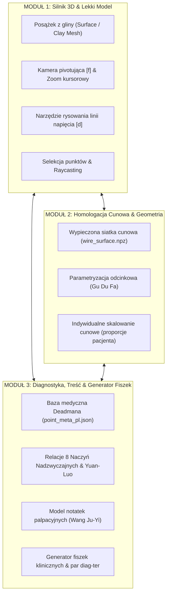

# Architektura, Badania i Modularny Rozwój Atlasu Akupunktury 3D

## Wprowadzenie
Niniejszy dokument stanowi kompendium wiedzy klinicznej, wyników badań anatomiczno-fizjoterapeutycznych oraz założeń architektonicznych dla projektu **Atlasu Akupunktury 3D i Silnika Diagnostyczno-Terapeutycznego**.

Dokument łączy wiedzę klasyczną Tradycyjnej Medycyny Chińskiej (TCM) ze współczesnymi badaniami biomechaniki powięziowej (fascia), mianownictwem anatomicznym standardu Bochenka oraz nowoczesną grafiką komputerową 3D czasu rzeczywistego.

---

## 1. Badania i Źródła Medyczno-Naukowe

### A. Klasyczna Siatka Cunowa: Pomiar Proporcjonalny (*Gu Du Fa* - 骨度法)
W Tradycyjnej Medycynie Chińskiej pojęcie miary *cun* nie jest jednostką metryczną o stałej długości, lecz **miarą proporcjonalną (relative/proportional measurement)**.
* **Źródło kanoniczne:** 14. rozdział *Ling Shu* (Miraculous Pivot / Oś Duchowa), zatytułowany *Gu Du* (Pomiar Długości Kości).
* **Zasada działania:** Odległość między kluczowymi wyniosłościami kostnymi (*bony landmarks*) dzieli się na stałą liczbę cunów, niezależnie od wzrostu, tuszy czy wieku pacjenta:
  * Przedramię (od zgięcia łokciowego do bruzdy nadgarstka): **12 cun** (niezmienna podstawa dla meridianów LU, PC, HT, LI, TE, SI).
  * Ramię (od fałdu pachowego do zgięcia łokciowego): **9 cun**.
  * Podudzie (od kłykcia piszczeli / dolnego brzegu rzepki do szczytu kostki bocznej): **16 cun** (dla ST-36 to 3 cun poniżej rzepki).
  * Udo (od krętarza większego do szczeliny stawu kolanowego): **19 cun**.
  * Klatka piersiowa (odległość między brodawkami sutkowymi): **8 cun**.
  * Brzuch (od kąta mostkowo-żebrowego do pępka): **8 cun**; od pępka do górnego brzegu spojenia łonowego: **5 cun**.
  * Głowa (od przedniej do tylnej linii włosów): **12 cun**; między wyrostkami sutkowatymi: **9 cun**.
* **Implikacja 3D (Homologacja):** W przestrzeni trójwymiarowej siatka cunowa nie może być płaską naklejką – musi stanowić parametryczny układ współrzędnych (*curved manifold parameterization*), gdzie pierścienie to równe podziały cunowe, a linie podłużne to azymuty.

---

### B. Powięziowe Łańcuchy Napięć a Przebiegi Meridianów
Współczesna biomechanika i badania histologiczne rzucają nowe światło na przebiegi meridianów:
* **Dr Helene Langevin (Harvard Medical School / NCCIH):**
  W pionierskich badaniach ultrasonograficznych i histologicznych wykazała ponad **80% zgodność anatomiczną** między punktami akupunkturowymi a międzymięśniowymi i śródmięśniowymi przegrodami łącznotkankowymi (*fascial planes*).
  * Zjawisko *Needle Grasp* (chwyt igły / de qi): mechaniczne nawijanie się włókien kolagenowych i fibroblastów wokół trzonu igły generuje sygnał mechanotransdukcyjny przekazywany wzdłuż łańcucha powięziowego.
* **Thomas Myers (*Anatomy Trains*):**
  Łańcuchy miofascialne (np. *Superficial Back Line*, *Superficial Front Line*, *Spiral Line*, *Arm Lines*) wykazują niemal 1:1 zbieżność z meridianami Pęcherza Moczowego (BL), Żołądka (ST), Pęcherzyka Żółciowego (GB) oraz meridianami kończyn górnych (LU/LI, HT/SI).
* **Dr Wang Ju-Yi (*Applied Channel Theory* / Teoria Zastosowania Meridianów):**
  Wprowadził rygorystyczny system badania palpacyjnego meridianów (*channel palpation*):
  * **Guzki (*jié kuài*):** przewlekłe zastoje Qi i Krwi, zwłóknienia powięziowe w bruzdach międzymięśniowych.
  * **Zagłębienia i ubytki tkanek (*depressions*):** stany niedoboru (Xu), atrofia tkanki podskórnej.
  * **Wzmożone napięcie (*hypertonicity/tightness*):** kompensacje posturalne i zastoje wątrobowe.

---

### C. 8 Naczyń Nadzwyczajnych (*Qí Jīng Bā Mài*) i Pary Nadrzędno-Sprzężone
Osiem Naczyń Nadzwyczajnych stanowi głęboki rezerwuar Qi i regulatora dynamiki posturalnej ciała. Sterowane są one przez tzw. **Osiem Punktów Zbiegu (*Bā Mài Jiāo Huì Xué* - 八脈交會穴)**:

1. **Ren Mai (Naczynie Poczęcia) & Yin Qiao Mai (Naczynie Piętowe Yin):**
   * Para: **LU-7 (Lieque)** ↔ **KI-6 (Zhaohai)**
   * Działanie: Brzuszna linia pośrodkowa, klatka piersiowa, gardło, płuca, układ moczowo-płciowy, odżywienie Yin.
2. **Du Mai (Naczynie Zarządzające) & Yang Qiao Mai (Naczynie Piętowe Yang):**
   * Para: **SI-3 (Houxi)** ↔ **BL-62 (Shenmai)**
   * Działanie: Kręgosłup, taśma tylna, potylica, mózg, wznoszenie Yang, eliminacja Wiatru.
3. **Chong Mai (Naczynie Przenikające) & Yin Wei Mai (Naczynie Łączące Yin):**
   * Para: **SP-4 (Gongsun)** ↔ **PC-6 (Neiguan)**
   * Działanie: Środek i dół brzucha, serce, krew, żołądek, nudności, zastoje w klatce piersiowej.
4. **Dai Mai (Naczynie Opasujące) & Yang Wei Mai (Naczynie Łączące Yang):**
   * Para: **GB-41 (Zulinqi)** ↔ **TE-5 / SJ-5 (Waiguan)**
   * Działanie: Pas, biodra, boki tułowia, strefa Shaoyang, migreny skroniowe, odporność (Wei Qi).

---

## 2. Diagnoza i Rozwiązanie Problemów Technicznych w Silniku

### Problem 1: Niewidoczność Siatki Cunowej na Ciele
* **Przyczyna geometryczna:**
  Wierzchołki `wire.npz` wyliczane były dokładnie na powierzchni skóry (mediana odległości $0.0\text{ mm}$). Ponieważ ciało ludzkie ma kształt wypukły, proste odcinki linii łączące wierzchołki wpadają pod krzywiznę powierzchni trójkątów skóry. Bufor głębokości (z-buffer) renderera ukrywał 95% linii.
* **Rozwiązanie:**
  Wygenerowano zoptymalizowany plik `data/wire_surface.npz` z radialnym reliefem zewnętrznym ($+1.8\text{ mm}$ wzdłuż normalnych powierzchni skóry). Siatka układa się teraz na ciele jak rzeźbiony grawer anatomiczny, bez z-fightingu i bez zakrywania przez skórę pod dowolnym kątem kamery.

### Problem 2: Brak Możliwości Zaznaczenia Punktów Płuc (LU)
* **Przyczyny:**
  1. Kod posiadał filtr: `if self.channels_on: visible = np.isin(self._mchan, list(self.channels_on))`. Po kliknięciu punktu ST włączał się kanał ST, co czyniło wszystkie pozostałe 13 kanałów nieklikalnymi.
  2. Test widoczności kamery opierał się na wektorze `m["pos"] - m["ref"]`, który na rotujących kończynach (przedramię) dawał fałszywe wartości ujemne.
  3. Punkty meridianów były domyślnie ukryte na starcie.
* **Rozwiązanie:**
  1. Usunięto ograniczenie kanałowe – wszystkie punkty akupunkturowe są stale widoczne jako perłowe markery w barwach 5 Przemian i klikalne w dowolnym momencie.
  2. Wprowadzono test widoczności w oparciu o kamerę i głębokość raycastu (`cam_to_m <= cam_to_p + 0.06`), co w 100% eliminuje fałszywe trafienia w plecy przy klikaniu klatki piersiowej, a jednocześnie bezbłędnie wybiera punkty na kończynach (LU-1..LU-11).

---

## 3. Nowa Estetyka i Narzędzia Interaktywne

1. **Posążek Gliniany o Zerowej Wadze (*Weightless Terracotta Figurine*):**
   * Ciepły, matowy odcień ceramiki rzeźbiarskiej (`#c49e7a`) z miękkim oświetleniem studyjnym (`ambient=0.48`, `diffuse=0.62`, `specular=0.06`).
   * Zapewnia płynne 60+ FPS i natychmiastowe obroty kamery wokół punktu zainteresowania (`[f]`).
2. **Narzędzie Szkicowania i Rysowania na Ciele (`[d]`):**
   * Klawisz `[d]` włącza tryb rysowania: przeciągnięcie myszą tworzy trójwymiarową linię naprężenia powięziowego przyklejoną do powierzchni skóry.
   * `[z]` cofa ostatnią linię, `[c]` czyści szkic.
3. **Wzbogacona Konsola Diagnostyczna:**
   * Po zaznaczeniu punktu konsola terminalowa wypisuje pełny raport Petera Deadmana, wzbogacony o powiązania z 8 Naczyniami Nadzwyczajnymi, parami Yuan-Luo i punktami Xi-Szczeliny.

---

## 4. Architektura i Modularny Podział Projektu

Aby projekt mógł stabilnie rozwijać się od obecnego prototypu konsolowego do pełnoprawnego produktu diagnostycznego, dzielimy go na 3 niezależne moduły:

### Moduł 1: Silnik 3D & Lekki Model (Frontend Geometryczny)
* **Zadanie:** Wizualizacja posążka, płynna manipulacja widokiem, obsługa wejścia (mysz, dotyk, skróty klawiszowe), rysowanie adnotacji na geometrii.
* **Format danych:** Lekkie siatki OBJ / PolyData, minimalne zużycie pamięci, brak ciężkich shaderów zwierciadlanych.

### Moduł 2: Homologacja Cunowa & Anatomiczna (Rdzeń Matematyczny)
* **Zadanie:** Precyzyjne rzutowanie siatki cunowej na indywidualne cechy sylwetki.
* **Zastosowanie:** Możliwość modyfikacji parametrów (np. zmiana proporcji kończyn, klatki piersiowej) i automatyczne przeliczanie lokalizacji punktów akupunkturowych wg zasad *Ling Shu*.

### Moduł 3: Baza Wiedzy, Mapa Napięć & Konsola Terapeutyczna (Rdzeń Merytoryczny)
* **Zadanie:** Łączenie punktów w logiczne łańcuchy diag-ter, generowanie fiszek edukacyjnych, notatki palpacyjne z badania pacjenta (guzki, napięcia, tkliwość Ashi), eksport raportów klinicznych.

---

## 5. Propozycje Optymalizacji i Kierunek Rozwoju Produktu

1. **Wersja Webowa (Three.js / WebGL / WebAssembly):**
   * Obecny silnik w Pythonie/VTK jest znakomity do szybkiego prototypowania i obliczeń geometrycznych.
   * W kolejnym kroku modularna struktura pozwala na wyeksportowanie posążka i siatki cunowej do formatu GLTF/JSON i uruchomienie w przeglądarce (WebGPU/Three.js) bez konieczności instalowania Pythona i WSL na komputerze lekarza/terapeuty.
2. **Kursor Diag-Ter (Smart Diagnostic Wand):**
   * Narzędzie pod kursorem mierzące w czasie rzeczywistym nie tylko odległość do punktu i cun, ale sugerujące punkty komplementarne (np. najechanie na LU-7 podświetla subtelnym promieniem KI-6 na kostce przyśrodkowej).
3. **Moduł Notatek Pacjenta (Elektroniczna Karta Badania Palpacyjnego):**
   * Możliwość zapisywania stanu pacjenta po zabiegu: zapis narysowanych linii napięć, oznaczonych punktów bolesnych Ashi oraz zaleconych kombinacji punktowych do pliku sesji JSON/PDF.
